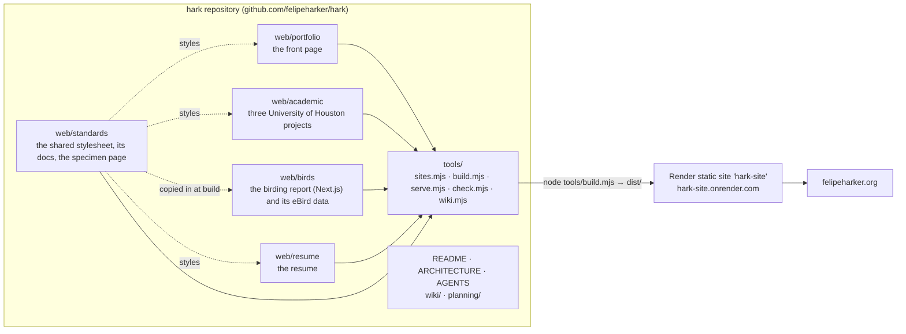
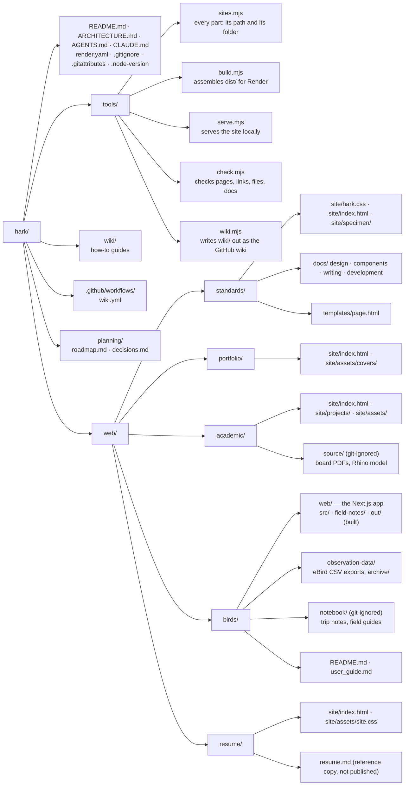
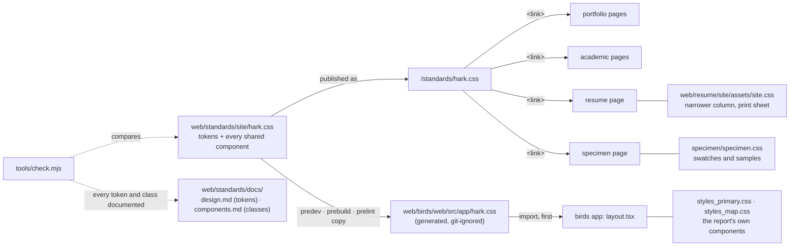
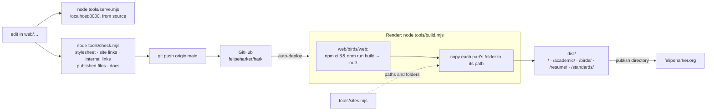
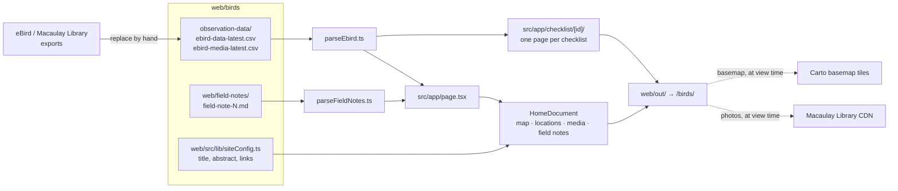
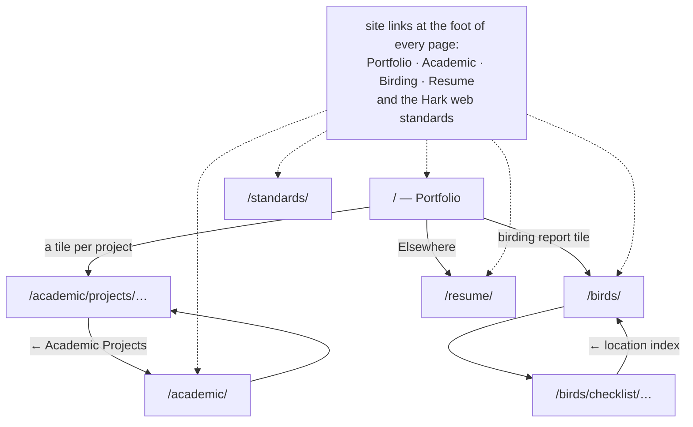

# Architecture

How felipeharker.org is put together: what lives where in this repository,
how the parts relate to each other, how a change becomes the live site, and
what sits outside the repository. The diagrams render on GitHub; every box
names a real folder, file or service.

- [The whole system](#the-whole-system)
- [The repository](#the-repository)
- [One stylesheet](#one-stylesheet)
- [From a commit to the live site](#from-a-commit-to-the-live-site)
- [The birding report's data](#the-birding-reports-data)
- [How a reader moves around](#how-a-reader-moves-around)
- [Outside the repository](#outside-the-repository)

## The whole system

One repository builds one static site, served from one domain. Each part of
the site is a folder under `web/`; one stylesheet in `web/standards/` styles
all of them; `tools/` turns the folders into the site.

| Path on felipeharker.org | Folder published | What it is |
|---|---|---|
| `/` | `web/portfolio/site/` | The front page: a tile for each academic project and one for the birding report, About, Elsewhere |
| `/academic/` | `web/academic/site/` | Living Outside the Box, Dead Mall Fall, Collingsworth Marketplace — a page each |
| `/birds/` | `web/birds/web/out/` (built) | The Harker Ornithology Report: map, locations, media, field notes, one page per checklist |
| `/resume/` | `web/resume/site/` | The resume, printable |
| `/standards/` | `web/standards/site/` | The specimen page, and `/standards/hark.css` itself |

## The repository

Every part keeps what it publishes in a `site/` folder and nothing else
there: no Markdown, notes, models or PDFs. Working files sit beside it in
`source/` (or the birding report's `notebook/`), which git ignores. The
birding report is the one part with a build: its app writes `web/out/`.

## One stylesheet

There is one shared stylesheet, `web/standards/site/hark.css`. Nothing copies
it except the birding app, which needs it at build time.

A part's own stylesheet loads after `hark.css`, may read and redefine its
tokens, and holds only what no other part needs. A component a second part
needs moves into `hark.css`.

## From a commit to the live site

`tools/sites.mjs` is the one list of parts: the build, the local server and
the check all read it, so a new part of the site is added there once.
`node tools/build.mjs && node tools/serve.mjs --dist` shows exactly what
Render will publish.

## The birding report's data

Nothing about birds is written into markup. Every page is built from files
at build time; images and map tiles come from outside services when a
reader opens the page.

## How a reader moves around

Every page ends with the same site links, so any part of the site is one
click from any other. Links between parts are root-relative and stay in the
same tab; links to anyone else open a new one.

## Outside the repository

| What | Where | Relationship |
|---|---|---|
| The live site | Render static site `hark-site` (project Hark, workspace Harker-Hub) | Builds `main` on every push; serves felipeharker.org and www |
| The GitHub wiki | github.com/felipeharker/hark/wiki | A copy of `wiki/`, replaced by `.github/workflows/wiki.yml` on every push to `main` that changes it |
| DNS | Porkbun | `felipeharker.org` A record → Render; `www` CNAME → `hark-site.onrender.com`; `birds` CNAME → the birding redirect service; `resume` → Porkbun's URL forwarding |
| resume.felipeharker.org | Porkbun URL forwarding | A permanent redirect to `/resume/`; nothing on Render |
| birds.felipeharker.org | Render service `hark-birding-redirect` (the old birding site) | Kept only to redirect to `/birds/` |
| resume-site-0rfl.onrender.com | Render service `hark-resume-redirect` (the old resume site) | Kept only to redirect to `/resume/` |
| `hark_portfolio`, `hark_resume`, `hark_birding` | GitHub, archived | The three repositories this one replaced; read-only, with their histories |
| `hark_system` | GitHub, archived | The old CODEBASE standards: its web standard now lives here, its Rhino / Grasshopper and repository standards in `parametric_living_standards` |
| `CODEBASE\parametric` | the private `parametric_*` repositories | The Rhino and Grasshopper work and its own standards; nothing here depends on it |
| Fonts | Google Fonts, by a `<link>` on every page (the birding app's in its `layout.tsx`) | Inter and IBM Plex Mono |
| Photos and map tiles | Macaulay Library CDN, Carto | Loaded by the birding report in the reader's browser |
